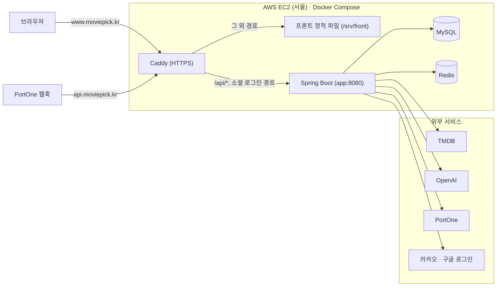

<div align="center">

# 🎬 MoviePick

**리뷰로 고르고, 커뮤니티로 나누고, AI로 발견하는 영화 추천 플랫폼**

<a href="https://www.moviepick.kr"></a>
<a href="https://github.com/300-moviepick/moviepick-front"></a>
<a href="https://github.com/300-moviepick/moviepick"></a>

[소개](#1-프로젝트-소개) · [주요 기능](#2-주요-기능) · [기술 스택](#3-기술-스택) · [구성도](#4-시스템-구성도) · [구조](#5-프로젝트-구조) · [기술적 고민](#6-기술적-고민과-해결) · [실행](#7-실행-방법) · [CI·배포](#8-ci--배포) · [팀](#9-팀원과-역할) · [문서](#10-문서-안내)

</div>

<br>

## 1. 프로젝트 소개

볼 영화를 고를 때 평점은 리뷰 몇 개에 쉽게 흔들리고, 리뷰와 이야기는 여러 곳에 흩어져 있습니다.
MoviePick은 영화 정보·리뷰·커뮤니티를 한곳에 모으고, 리뷰 수를 반영한 베이지안 랭킹으로 믿을 수 있는 순위를 보여 줍니다.
보고 싶은 영화를 문장으로 적으면 AI가 문장의 의미와 내 리뷰 취향을 함께 반영해 3편을 추천합니다.

**프로젝트 목표**
- 리뷰 수가 적은 영화가 순위를 흔들지 않는 랭킹
- 동시 요청에서도 어긋나지 않는 데이터 (제재 차수, 크레딧, 결제 지급)
- 실패해도 사용자가 손해 보지 않는 AI 추천 (크레딧 복구)
- 50명 동시 요청 p95 500ms 이내를 기준으로 한 성능 측정과 개선

| 항목 | 내용 |
|---|---|
| 기간 | 2026년 10월 ~ 11월 (약 4~5주) |
| 팀 | 5명 |
| 운영 주소 | https://www.moviepick.kr |
| 화면 | 반응형 웹 |

<br>

## 2. 주요 기능

### 1️⃣ **영화 탐색과 베이지안 랭킹**
TMDB에서 수집한 영화를 검색하고 상세(예고편·출연진·OTT)를 봅니다. 랭킹은 리뷰가 1개 이상인 영화를 대상으로, 기준 리뷰 수 10과 전체 평균 평점으로 보정한 베이지안 평균을 씁니다. 리뷰 1~2개짜리 영화가 상위를 차지하지 않습니다.

### 2️⃣ **리뷰와 평점**
평점은 0.5~5.0점(0.5 단위), 내용은 1,000자 이내입니다. 회원당 영화 하나에 리뷰 하나(UNIQUE)이며, 좋아요와 최신·좋아요·평점순 정렬을 지원합니다. 리뷰 수와 평점 합계는 영화 행에 원자적 UPDATE로 반영합니다.

### 3️⃣ **커뮤니티**
게시글(제목 100자, 본문 5,000자)과 댓글(500자)을 쓰고 좋아요·신고를 합니다. 인기순 목록은 앞 5페이지를 3분 캐시해 50명 동시 요청 p95를 7,477ms에서 17ms로 줄였습니다.

### 4️⃣ **찜과 개봉 알림**
매일 09:00(서울)에 오늘 개봉하는 찜 영화마다 회원별 알림을 1건씩 만듭니다. `영화 ID + 개봉일` 이벤트 키에 UNIQUE를 걸어 같은 알림이 두 번 생기지 않습니다.

### 5️⃣ **AI 추천과 크레딧**
요청 문장의 의미(임베딩)와 내 리뷰 장르 선호로 3편을 고르고 이유를 생성합니다. 외부 AI 호출 전에 크레딧 1개를 차감하고, 실패하면 같은 버킷으로 복구합니다. 가입 시 무료 크레딧 3개를 주며, 모든 변동은 원장에 남습니다. 추천 피드백(좋아요·싫어요)은 서버 API·점수 반영 구현, 화면 연결 예정입니다.

### 6️⃣ **결제 (후원·AI 크레딧)**
PortOne V2로 후원(3,000·6,000·9,000원)과 AI 크레딧 구매를 처리합니다. 결제 확인 요청(confirm)과 웹훅을 함께 받고, 조건부 UPDATE로 둘이 동시에 오거나 여러 번 와도 지급은 1번만 합니다. 웹훅은 서명(HMAC-SHA256)을 검증합니다.

### 7️⃣ **관리자 신고·제재**
신고를 승인하면 콘텐츠를 숨기고 작성자를 누적 횟수에 따라 단계별로 정지합니다(1회 1일, 2회 7일, 3회 이상 영구). 관리자 두 명이 동시에 승인해도 차수가 정확하도록 회원 행부터 잠급니다. → [동시 승인 트러블슈팅](docs/troubleshooting/02-admin-report-concurrency.md)

<br>

## 3. 기술 스택

| 분류 | 기술 | 용도 |
|---|---|---|
| Language |   | 백엔드, 프론트엔드 |
| Backend |     | API 서버, 동적 쿼리, TMDB 영화 수집 배치 |
| Security |    | JWT 인증, Refresh Token 교체, 카카오·구글 로그인, CSRF |
| Database·Cache |   | 주 저장소, Refresh Token·목록 캐시 |
| AI |   | gpt-4o-mini 추천 이유, text-embedding-3-small 임베딩 |
| Frontend |    | 화면 ([프론트 저장소](https://github.com/300-moviepick/moviepick-front)) |
| Infra |    | 서버 1대, 컨테이너 4개, HTTPS·리버스 프록시·정적 파일 |
| CI·Test |      | 빌드·테스트, 패키지 규칙 검사, 커버리지, 부하 테스트 |
| Open API |     | 영화 데이터, 결제(테스트 모드), 소셜 로그인 |
| Collaboration |   | 조직 저장소·PR, AI 코드 리뷰 |

<br>

## 4. 시스템 구성도



| 구성 | 설명 |
|---|---|
| Caddy | HTTPS 인증서 자동 발급·갱신. `www.moviepick.kr`에서 `/api/*`·소셜 로그인 경로만 앱으로 넘기고 나머지는 프론트 파일로 응답합니다. 루트 주소는 www로 영구 이동합니다 |
| 프론트 정적 파일 | 프론트 빌드 결과를 Caddy가 읽기 전용으로 제공합니다. 없는 경로는 `index.html`로 돌려줘 새로고침해도 화면이 유지됩니다 |
| Spring Boot | API 서버(prod 프로필, 힙 상한 1GB). PortOne 웹훅은 `api.moviepick.kr`로 받습니다 |
| MySQL · Redis | 외부 포트 없이 컨테이너 내부망에서만 씁니다. 외부에 여는 포트는 Caddy의 80·443뿐입니다 |
| 외부 서비스 | TMDB(영화 수집), OpenAI(추천 이유·임베딩), PortOne(결제 확인), 카카오·구글(로그인) |

<br>

## 5. 프로젝트 구조

```
src/main/java/com/moviepick
├─ domain
│  ├─ admin          관리자 API (회원·신고·콘텐츠·영화 관리)
│  ├─ ai             AI 추천(recommendation)·크레딧(credit)
│  ├─ community      게시글·댓글·좋아요, 인기글 캐시
│  ├─ member         회원가입·로그인·소셜 로그인
│  ├─ movie          영화 조회·랭킹, TMDB 수집 배치
│  ├─ notification   개봉 알림 스케줄러·알림 센터
│  ├─ payment        PortOne 결제 공통(웹훅 검증·상품별 분기)
│  ├─ report         신고 접수·승인·제재
│  ├─ review         리뷰·평점·좋아요, 좋아요순 캐시
│  ├─ support        후원 결제
│  └─ wishlist       찜
└─ global            config · entity · exception · response · security · validation
```

**레이어 규칙** — `ArchitectureTest`(ArchUnit)가 테스트로 강제합니다. 어기면 빌드가 실패합니다.

| 규칙 | 의미 |
|---|---|
| `global`은 `domain`에 의존하지 않습니다 | 공통 코드가 특정 기능에 묶이지 않습니다 |
| `domain` 패키지 사이에 순환이 없습니다 | 도메인 간 호출은 포트 인터페이스로 방향을 끊습니다 (예: `SignupBenefitPort` 회원가입 → 무료 크레딧, `PaidPaymentHandler` 결제 → 후원·크레딧 지급, `MovieReviewReader` 영화 → 리뷰 집계) |
| PortOne 웹훅 공통 컴포넌트는 결제 유형 코드에 의존하지 않습니다 | 웹훅 수신·서명 검증은 후원·AI 크레딧 코드를 모릅니다. 상품이 늘어도 공통 코드는 그대로입니다 |
| `admin`은 repository·entity를 직접 쓰지 않습니다 | 관리자 기능도 각 도메인 서비스를 거쳐 규칙(잠금·상태 검사)을 지킵니다 |

<br>

## 6. 기술적 고민과 해결

### 🛠️ 트러블슈팅

| 문제 | 해결 | 결과 |
|---|---|---|
| [리뷰 좋아요순 목록 11초](docs/troubleshooting/01-review-likes-cache.md) | 좋아요순일 때만 앞 5페이지를 `@Cacheable(sync = true)`로 3분 캐시 | p95 11,078ms → 11.13ms |
| [관리자 신고 동시 승인](docs/troubleshooting/02-admin-report-concurrency.md) | 회원 행 잠금 → 신고 행 잠금, PENDING 조건부 UPDATE, 신고당 제재 1건 UNIQUE | 동시 승인 4가지 상황을 동시성 테스트로 검증 |
| [동시 쓰기 데드락](docs/troubleshooting/03-write-deadlock.md) | 쓰기 잠금을 먼저 잡도록 순서 통일 (댓글 수 선증가, 영화 → 리뷰 잠금) | 데드락 500 사라짐, 평점 합계 불일치 0건 |
| [Refresh Token 재사용](docs/troubleshooting/04-refresh-token-reuse.md) | `getAndDelete`로 1회용 교체, 재사용 감지 시 전체 무효화, 프론트 재발급 통합·Web Locks | 탈취된 토큰 재사용 시 401과 전체 무효화 |
| [AI 응답 형식 불일치](docs/troubleshooting/05-ai-response-format.md) | 구조화 출력(JSON 스키마) + 서버 검증 + 최대 2회 시도 + 크레딧 복구 | 잘못된 응답이 사용자에게 나가지 않음 |
| [운영 임베딩 미생성 발견](docs/troubleshooting/06-missing-embeddings.md) | 의미 점수가 빠진 채 대체 동작하던 것을 찾아 운영 영화 임베딩 일괄 생성 | "마블 영화 추천해줘" → 마블 영화 3편, 주제 인식 |
| [GitHub 계정 제한으로 막힌 프론트 배포](docs/troubleshooting/07-frontend-deploy-caddy.md) | EC2 Caddy가 화면과 API를 같은 주소로 제공 (단일 출처) | 상대 경로 API 호출, Refresh 쿠키 `SameSite=Strict` |

### ⚡ 성능 개선

| 개선 | 방법 | 결과 (p95) |
|---|---|---|
| 리뷰 좋아요순 목록 | 결과 캐시 (앞 5페이지, TTL 3분) | 11,078ms → **11.13ms** |
| 커뮤니티 인기글 목록 | 결과 캐시 (검색어 없을 때만) | 7,477ms → **17ms** |
| 관리자 신고 목록 | N+1 제거 (IN 쿼리) + 상태·작성일 인덱스 | 84ms → **23ms** |
| 관리자 신고 목록 (500명 동시 요청) | 〃 | 2,245ms → **452ms** |

측정 조건: k6 50명 동시 요청 p95, 로컬 측정, 같은 측정자·같은 PC 전후 비교. 500명 행은 같은 조건에서 동시 요청 수만 늘렸습니다. → [성능 개선 상세](docs/performance.md)

### 💡 기술적 의사결정

| 결정 | 선택 | 이유 |
|---|---|---|
| 결제 확인 | confirm + 웹훅 이중 처리 | 브라우저가 닫혀도 웹훅으로 지급합니다. 결제 행을 `CREATED → PAID` 조건부 UPDATE로 바꿔, 0행이면 이미 처리된 것으로 보고 지급을 1번만 합니다 |
| 크레딧 저장 | 지갑(잔액) + 원장(모든 변동) | 사용·확정·복구를 한 줄씩 추적하고, `idempotency_key` UNIQUE와 이벤트별 delta CHECK로 중복·잘못된 변동을 DB에서 막습니다 |
| 랭킹 계산 | 베이지안 평균 (기준 리뷰 수 10) | 단순 평균은 리뷰 1~2개짜리 영화가 상위를 차지합니다. 리뷰가 적을수록 전체 평균 쪽으로 보정합니다 |
| 좋아요 수 | 컬럼 없이 집계 + 앞 페이지 캐시 | 카운터 컬럼과 실제 좋아요 수가 어긋나지 않습니다. 무거운 정렬은 캐시로 보완했습니다 |
| 소셜 로그인 콜백 | 프론트 주소(www)로 고정 | Refresh 쿠키가 화면 도메인에 저장되어 `SameSite=Strict`를 유지합니다 |
| 서버 구성 | EC2 1대 + Docker Compose | `docker-compose.prod.yml` 하나로 app·mysql·redis·caddy를 띄우고, 외부 포트는 Caddy 80·443만 엽니다 |
| AI 스위치 | `spring.ai.model.chat` 기본값 `none` | AI를 끄면 추천·크레딧 상품 API가 등록되지 않습니다(404). 이미 돈을 낸 크레딧 결제 확인은 AI를 꺼도 항상 등록됩니다 |

### 🔭 AI 추천의 한계와 다음 단계

**실제 결과**: "마블 영화 추천해줘" 요청에 더 마블스, 캡틴 마블, 썬더볼츠*를 추천합니다. 작품 이름·시리즈처럼 영화 소개에 드러나는 주제는 잘 찾습니다.

**한계**: "비 오는 밤 잔잔한 영화" 같은 분위기 요청에서는 스크림 같은 작품이 섞입니다. 임베딩 유사도는 요청 문장과 영화 소개 문장이 얼마나 비슷한지만 보므로, 분위기·장르처럼 소개 문장에 직접 드러나지 않는 조건을 구분하지 못합니다.

**다음 단계 (미도입, 설계 방향)**
- **Graph RAG**: 영화–시리즈·출연진·감독·장르를 그래프로 연결하고, 벡터 검색으로 찾은 영화에서 관계를 따라 후보를 넓히는 방식을 설계 방향으로 잡고 있습니다. 현재 코드에는 들어 있지 않습니다.
- **추천 피드백 화면 연결**: 서버 API(`PUT`·`DELETE /api/ai/feedback/{movieId}`)와 점수 반영(싫어요 제외, 좋아요 장르 가점)은 구현되어 있고, 화면 버튼 연결이 남아 있습니다.
- **추천 품질 평가**: 요청 유형별 기대 결과를 정해 추천 결과를 측정하는 평가 체계를 만듭니다.

<br>

## 7. 실행 방법

**요구 환경**: JDK 17, Docker Desktop

```bash
cp .env.example .env
```
```bash
docker compose up -d
```
```bash
./gradlew bootRun
```
```bash
./gradlew test
```

- `.env`에 `JWT_SECRET`, `TMDB_ACCESS_TOKEN` 등 비밀값을 채웁니다. 영화 덤프 준비, DB 초기화 확인, IntelliJ 설정은 [docs/DEVELOPMENT.md](docs/DEVELOPMENT.md)를 봅니다.
- 테스트는 H2로 실행됩니다. 596개 중 592개 성공, 실패 0, 건너뜀 4입니다. 건너뛴 4개는 실제 MySQL이 필요한 관리자 동시성 테스트로, `TEST_DB_PASSWORD`가 있을 때만 실행됩니다.

<br>

## 8. CI · 배포

| 항목 | 내용 |
|---|---|
| CI | GitHub Actions. `dev`·`main`으로 가는 PR과 push마다 JDK 17로 `./gradlew build`(테스트 포함)를 실행하고, PR에는 JaCoCo 커버리지를 댓글로 남깁니다 (`.github/workflows/ci.yml`) |
| 코드 리뷰 | CodeRabbit이 `dev`·`main` 대상 PR을 한국어로 자동 리뷰합니다 (`.coderabbit.yaml`) |
| 브랜치 | 기능 브랜치 → `dev` → `main` |
| 배포 | 자동 배포(CD)는 없습니다. `main` 기준으로 PC에서 만든 압축 파일을 EC2에 올리고 `docker compose -f docker-compose.prod.yml up -d --build`로 띄웁니다. 프론트는 빌드 결과를 서버 폴더에 올리면 Caddy가 바로 제공합니다. 절차는 [docs/DEPLOYMENT.md](docs/DEPLOYMENT.md)를 봅니다 |

<br>

## 9. 팀원과 역할

| 이름 | GitHub | 담당 |
|---|---|---|
| **강성현** (팀장) |  | • 프로젝트 총괄, PortOne 후원·AI 크레딧 결제(confirm + 웹훅 지급 1회)<br>• EC2·Docker Compose·Caddy 운영 배포<br>• 프론트엔드 화면 구현 |
| 박지민 | <a href="https://github.com/bagj5082-source"></a> | • 회원가입·로그인, JWT 인증<br>• 찜, 개봉 알림 스케줄러·알림 센터<br>• 관리자 API, 신고 목록 N+1 제거·인덱스 |
| 김혁중 | <a href="https://github.com/ihateahri"></a> | • TMDB 영화 수집(Spring Batch)과 영화 데이터<br>• AI 추천: 임베딩 의미 점수, 리뷰 장르 선호, 추천 이유 생성 |
| 안우성 | <a href="https://github.com/WsungAn"></a> | • 리뷰·평점·좋아요, 좋아요순 결과 캐시<br>• 리뷰·댓글 쓰기 데드락 방지, Refresh Token 1회용 교체·재사용 감지<br>• 부하 테스트와 최적화 |
| 이건희 | <a href="https://github.com/gunhee530"></a> | • 커뮤니티 게시글·댓글·좋아요<br>• 인기글 결과 캐시<br>• 영화 랭킹 |

<br>

## 10. 문서 안내

| 문서 | 내용 |
|---|---|
| [docs/DEVELOPMENT.md](docs/DEVELOPMENT.md) | 로컬 실행, IntelliJ 설정, 영화 데이터 수집, 문제 해결, 개발 규칙 |
| [docs/DEPLOYMENT.md](docs/DEPLOYMENT.md) | EC2 운영 배포 절차, 운영 `.env` 체크리스트 |
| [docs/api.md](docs/api.md) | API 명세 (공통 규칙, 도메인별 엔드포인트 63개) |
| [docs/erd.md](docs/erd.md) | ERD, 테이블 목록, 설계 규칙 |
| [docs/performance.md](docs/performance.md) | 성능 측정 조건, 개선 전후, 남은 한계 |
| [docs/troubleshooting/](docs/troubleshooting/) | 트러블슈팅 7건 |
