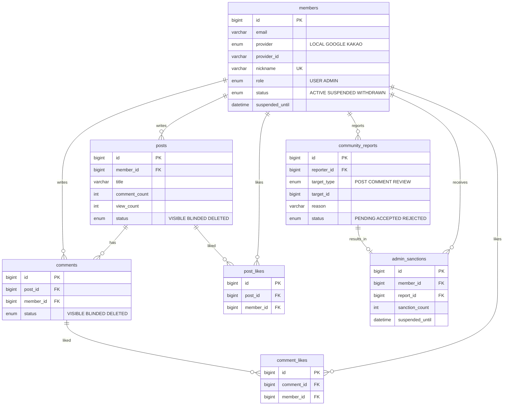
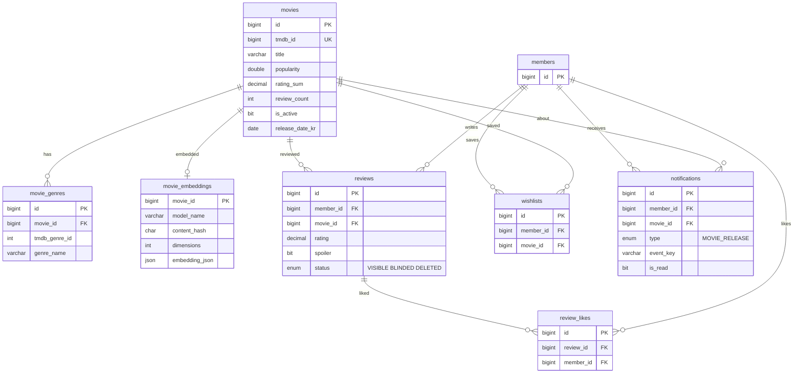
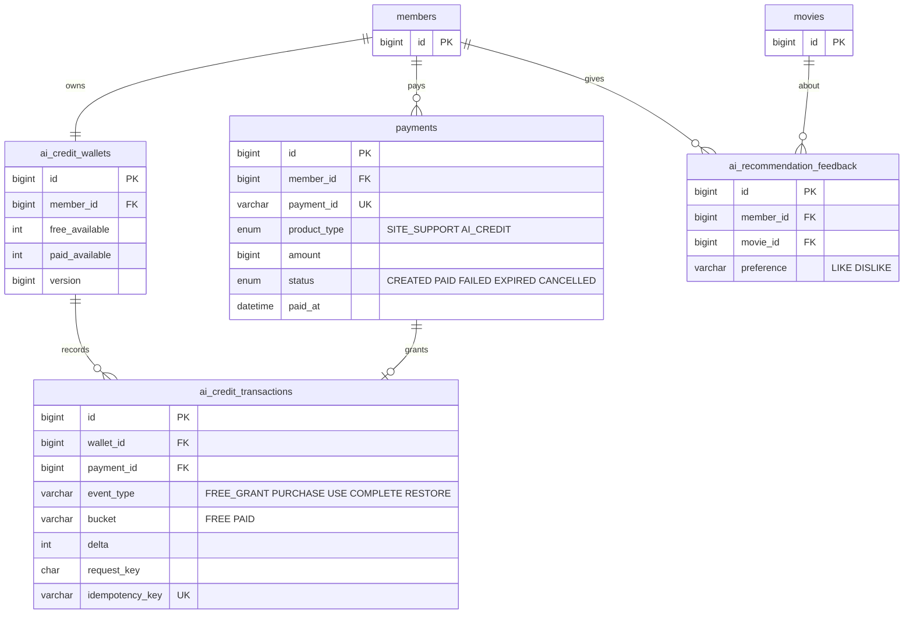

# ERD

> 근거: `db/schema.sql`, `db/ai-credit-wallet-schema.sql`, `db/ai-credit-transactions-schema.sql`, `db/ai-recommendation-feedback-schema.sql`, `db/movie-embeddings-schema.sql`, `db/batch-schema.sql`
> DB는 `db/init/00-init.sh` 순서(schema → movie-embeddings → ai-credit-wallet → ai-credit-transactions → ai-recommendation-feedback → batch → data)로 처음 한 번 만들어집니다. 앱은 `ddl-auto: validate`로 엔티티와 DB가 같은지만 확인합니다.
> 다이어그램에는 주요 컬럼만 넣었습니다. Spring Batch 기본 테이블(BATCH_*)은 뺐습니다.

## 1. 회원 · 커뮤니티 · 신고

## 2. 영화 · 리뷰 · 찜 · 알림

## 3. 결제 · AI 크레딧

## 4. 테이블 목록

| 테이블 | 설명 | 주요 제약 | 근거 |
|---|---|---|---|
| members | 회원(일반·카카오·구글). 역할과 정지 상태를 가집니다 | UNIQUE(email, provider), UNIQUE(provider, provider_id), UNIQUE(nickname) | `db/schema.sql` |
| posts | 커뮤니티 게시글. 댓글 수·조회 수를 컬럼으로 둡니다 | 인덱스(status, created_at) | `db/schema.sql` |
| comments | 게시글 댓글 | 인덱스(post_id, status, created_at) | `db/schema.sql` |
| post_likes | 게시글 좋아요 | UNIQUE(post_id, member_id) | `db/schema.sql` |
| comment_likes | 댓글 좋아요 | UNIQUE(comment_id, member_id) | `db/schema.sql` |
| community_reports | 게시글·댓글·리뷰 신고. 대상은 target_type + target_id로 가리킵니다(외래키 없음) | UNIQUE(reporter_id, target_type, target_id), 인덱스(status, created_at, id), (created_at, id) | `db/schema.sql` |
| admin_sanctions | 신고 승인으로 생긴 제재 기록. 제재 차수와 정지 종료 시각을 저장합니다 | UNIQUE(report_id) | `db/schema.sql` |
| movies | TMDB에서 가져온 영화. 리뷰 수·평점 합계를 컬럼으로 둡니다 | UNIQUE(tmdb_id) | `db/schema.sql` |
| movie_genres | 영화 장르 | UNIQUE(movie_id, tmdb_genre_id) | `db/schema.sql` |
| movie_embeddings | AI 추천용 영화 임베딩(영화 1편당 1행) | PK = movie_id(영화 삭제 시 함께 삭제), CHECK dimensions > 0 | `db/movie-embeddings-schema.sql` |
| reviews | 영화 리뷰. 평점은 0.5~5.0, 0.5 단위(`Review.java`) | UNIQUE(member_id, movie_id) | `db/schema.sql` |
| review_likes | 리뷰 좋아요 | UNIQUE(member_id, review_id) | `db/schema.sql` |
| wishlists | 찜 | UNIQUE(member_id, movie_id) | `db/schema.sql` |
| notifications | 개봉 알림 | UNIQUE(member_id, event_key) | `db/schema.sql` |
| payments | 결제(후원·AI 크레딧 공통) | UNIQUE(payment_id) | `db/schema.sql` |
| ai_credit_wallets | 회원별 AI 크레딧 지갑(무료·유료 잔액) | UNIQUE(member_id), CHECK 잔액 ≥ 0, version(낙관적 잠금) | `db/ai-credit-wallet-schema.sql` |
| ai_credit_transactions | 크레딧 변동 원장(지급·구매·사용·확정·복구) | UNIQUE(idempotency_key), CHECK bucket, CHECK 이벤트별 delta | `db/ai-credit-transactions-schema.sql` |
| ai_recommendation_feedback | AI 추천 영화에 대한 좋아요·싫어요 | UNIQUE(member_id, movie_id), CHECK preference | `db/ai-recommendation-feedback-schema.sql` |
| BATCH_* | Spring Batch 실행 이력(영화 수집 배치) | Spring Batch 기본 구조 | `db/batch-schema.sql` |

※ `Review.java`는 `src/main/java/com/moviepick/domain/review/entity/Review.java`입니다.

## 5. 설계 규칙

- **중복은 DB UNIQUE로 막습니다.** 좋아요·찜·리뷰(회원당 영화 1개)·신고(같은 대상 1번)·알림(event_key)은 모두 UNIQUE 제약이 있습니다. 코드는 제약 이름으로 중복 오류를 구분하므로 이름을 바꾸지 않도록 적어 두었습니다(`db/schema.sql`).
- **크레딧은 지갑 + 원장 방식입니다.** 잔액은 `ai_credit_wallets`에, 모든 변동은 `ai_credit_transactions`에 한 줄씩 남깁니다. 이벤트마다 delta 값이 CHECK로 고정됩니다(사용 -1, 복구 +1, 확정 0)(`db/ai-credit-transactions-schema.sql`). `idempotency_key` UNIQUE로 같은 지급·사용이 두 번 기록되지 않습니다.
- **삭제는 상태값으로 처리합니다.** 게시글·댓글·리뷰는 행을 지우지 않고 status를 `DELETED` 또는 `BLINDED`(관리자 숨김)로 바꿉니다(`db/schema.sql`).
- **자주 쓰는 집계는 컬럼으로 둡니다.** 게시글 댓글 수(`posts.comment_count`), 영화 리뷰 수·평점 합계(`movies.review_count`, `movies.rating_sum`)는 컬럼입니다. 반면 좋아요 수는 컬럼 없이 좋아요 테이블을 집계합니다(`reviews`·`posts`에 like_count 컬럼 없음, `db/schema.sql`).
