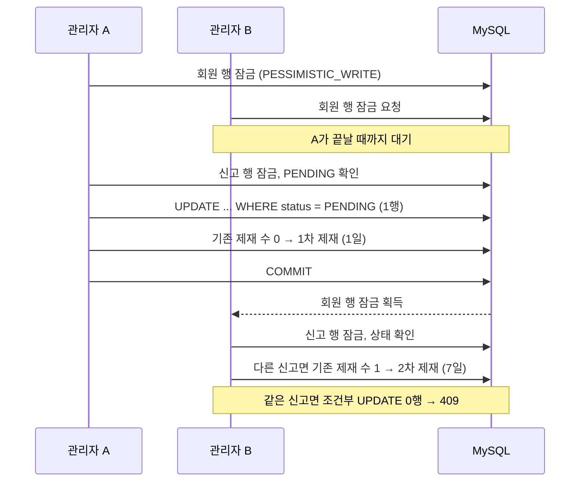

# 관리자 신고 동시 승인 → 회원 잠금과 조건부 UPDATE

> 같은 회원에 대한 신고를 동시에 승인해도 제재 차수와 정지 기간이 정확하게 쌓이도록, 회원 행 잠금 → 신고 행 잠금 순서와 PENDING 조건부 UPDATE, UNIQUE 제약을 함께 적용했습니다.

## 문제
같은 회원의 신고를 관리자 두 명이 거의 동시에 승인하면, 두 요청이 모두 "기존 제재 0회"를 읽고 둘 다 1차 제재로 저장할 수 있었습니다(갱신 손실).

## 원인
- 제재 차수는 `admin_sanctions`에서 그 회원의 기존 제재 수를 세어 +1로 정합니다(`AdminReportService`).
- 차수에 따라 정지 기간이 1일 → 7일 → 영구로 바뀝니다. 동시에 세면 **차수와 정지 기간이 틀어지고**, 같은 신고나 같은 대상에 제재가 **두 번** 생길 수 있습니다.

## 해결
1. **잠금 순서**: 신고 대상 작성자(회원) 행을 먼저 `PESSIMISTIC_WRITE`로 잠그고, 그다음 신고 행을 잠급니다(`AdminReportService`, `MemberRepository`). 같은 회원에 대한 승인은 한 줄로 서므로 차수를 정확히 셉니다.
2. **상태 재확인 + 조건부 UPDATE**: 잠근 뒤 PENDING인지 다시 확인하고, `WHERE status = PENDING` 조건부 UPDATE가 0행이면 409로 막습니다(`CommunityReportRepository`).
3. **대상당 제재 1번**: 같은 대상에 이미 제재가 있으면 다시 제재하지 않습니다. 이 확인은 회원 잠금 안에서 합니다.
4. **UNIQUE 제약**: 신고 하나당 제재 하나(`admin_sanctions.report_id` UNIQUE), 같은 신고자·같은 대상 신고 1번(`community_reports` UNIQUE).

## 결과
`AdminReportConcurrencyTest`가 두 스레드를 동시에 출발시켜 4가지 상황을 확인합니다.

| 상황 | 기대 결과 |
|---|---|
| 같은 작성자의 다른 글 2건 동시 승인 | 제재 2건, 차수 1·2, 정지 +1일·+7일 |
| 같은 신고 동시 승인 | 1건만 성공, 제재 1건 |
| 같은 글의 다른 신고 동시 승인 | 1건만 성공, 제재 1건 |
| 같은 신고 승인·거절 동시 | 하나만 반영 |

이 테스트는 실제 MySQL이 필요해 환경변수 `TEST_DB_PASSWORD`가 있을 때만 실행됩니다. 일반 테스트 실행(596개)에서는 건너뜀 4개로 집계됩니다.

## 배운 점
동시성 문제는 격리 수준만으로 풀리지 않습니다. 무엇을 기준으로 줄을 세울지(회원 잠금)와 상태 조건(조건부 UPDATE), 마지막 방어선(UNIQUE)을 함께 정해야 합니다.
