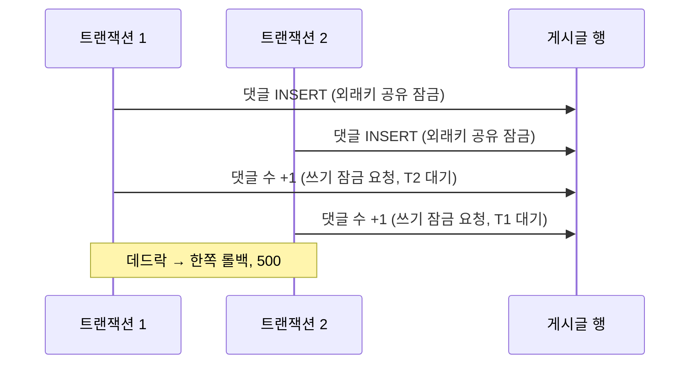

# 동시 쓰기 데드락 → 쓰기 잠금을 먼저 잡기

> 같은 영화의 리뷰, 같은 게시글의 댓글에 쓰기가 몰릴 때 나던 간헐적 500을, 잠금 순서를 하나로 맞춰 없앴습니다.

## 문제
같은 영화에 리뷰를 동시에 쓰거나 같은 게시글에 댓글이 몰리면 간헐적으로 500 응답이 났습니다.

## 원인
두 트랜잭션이 같은 자원을 반대 순서로 잠갔습니다. 예를 들어 댓글 INSERT는 외래키 때문에 게시글 행에 공유 잠금을 겁니다. 그 뒤 댓글 수 +1이 같은 행에 쓰기 잠금을 요청하면, 공유 잠금을 쥔 두 트랜잭션이 서로를 기다립니다.

## 해결
쓰기 잠금을 가장 먼저 잡도록 순서를 통일했습니다.
- **댓글**: 댓글 수 증가(원자적 UPDATE)를 INSERT보다 먼저 실행합니다(`CommentService`).
- **리뷰 작성·수정·삭제·숨김**: 영화 행을 먼저 잠그고(`findByIdForUpdate`) 그다음 리뷰를 다룹니다(`ReviewService`).
- **평점 합계·리뷰 수**: 조건부 원자적 UPDATE로 반영합니다(`MovieRepository`).
- 리뷰 좋아요는 카운터 컬럼 없이 `review_likes` INSERT 한 번으로 끝나므로 이 잠금 경합에 들어가지 않습니다(`ReviewLikeService`).

## 결과
- 데드락으로 인한 500이 사라졌습니다.
- 같은 영화에 50명이 리뷰 작성·삭제를 반복해도 실패율 0%, 평점 합계 불일치 0건이었습니다(p95 426ms, k6 로컬 측정).
- 같은 영화에 대한 쓰기는 영화 행 잠금으로 줄을 서므로 대기 시간이 늘 수 있습니다.

## 배운 점
여러 행을 잠그는 트랜잭션은 잠금 순서를 하나로 통일합니다. 외래키가 거는 암묵적 잠금도 순서에 포함해 생각해야 합니다.
