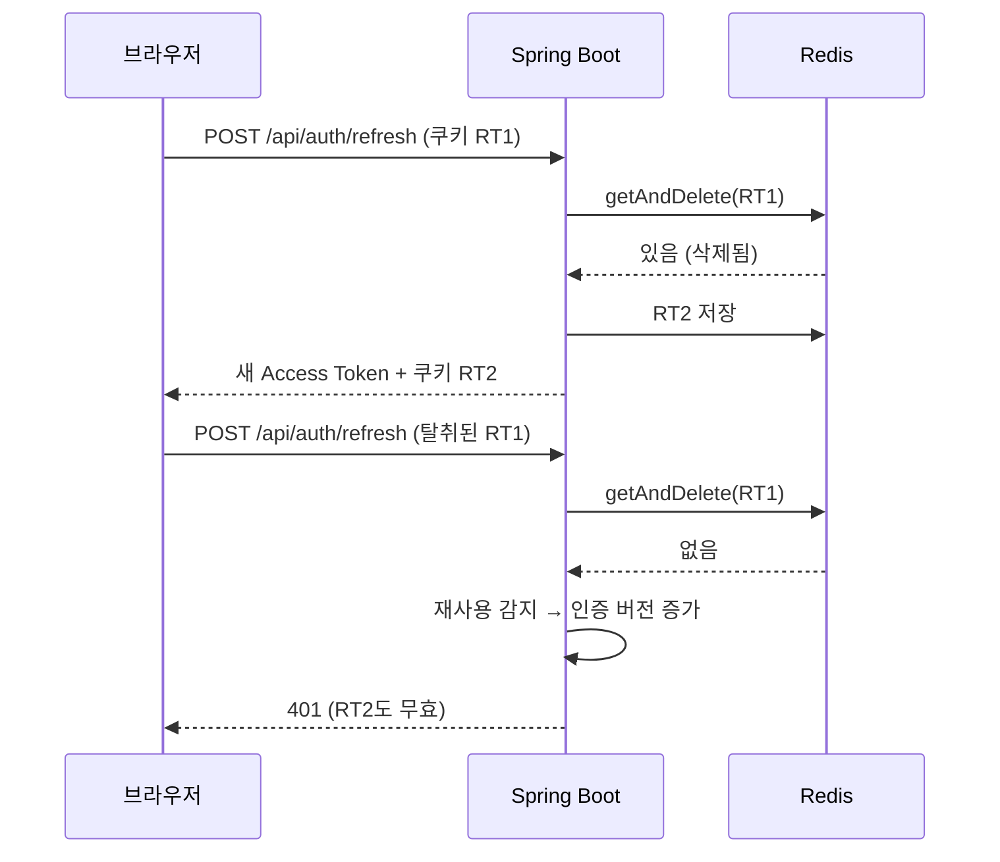

# Refresh Token 재사용 → 1회용 교체와 재사용 감지

> 14일 동안 같은 Refresh Token을 계속 쓰던 구조를, 쓸 때마다 새 토큰으로 바꾸고 이미 쓴 토큰이 오면 모든 토큰을 무효화하도록 바꿨습니다.

## 문제
재발급 때 Access Token만 새로 주고 Refresh Token은 14일 동안 그대로 썼습니다. 쿠키가 털리면 만료 전까지 계속 재발급받을 수 있었습니다.

## 원인
저장소(Redis)에 토큰이 있는지 확인만 하고 지우지 않아, 처음 쓰는 토큰과 이미 쓴 토큰을 구분할 수 없었습니다.

## 해결
- Redis `getAndDelete`로 꺼내면서 지워 한 번만 쓰게 합니다(`RefreshTokenService`).
- 서명은 맞는데 저장소에 없으면 재사용으로 보고, 회원의 인증 버전을 올려 모든 Refresh Token을 무효화합니다(`AuthService`).
- 재발급 응답에 새 Refresh 쿠키(HttpOnly, SameSite=Strict, Path=/api/auth)를 함께 내려줍니다(`AuthController`, `RefreshTokenCookieFactory`).
- **프론트 대응**: 같은 토큰으로 재발급이 두 번 오면 두 번째가 재사용으로 판정됩니다. 그래서 프론트는 재발급 요청을 탭 안에서 하나로 합치고(`refreshPromise`), 탭 사이는 Web Locks(`navigator.locks`)로 순서를 맞춥니다(`moviepick-fe/src/api/client.js`).

## 결과
`AuthServiceRefreshTest`가 교체(`rotate`)와 재사용 감지(`reuseDetected`)를 검증합니다. 이미 쓴 토큰이 오면 401과 함께 그 회원의 토큰이 모두 무효화됩니다.

## 배운 점
보안을 강화하면 정상 사용자의 동시 요청이 공격처럼 보일 수 있습니다. 서버 규칙을 바꿀 때 클라이언트의 요청 방식도 함께 맞춰야 합니다.
