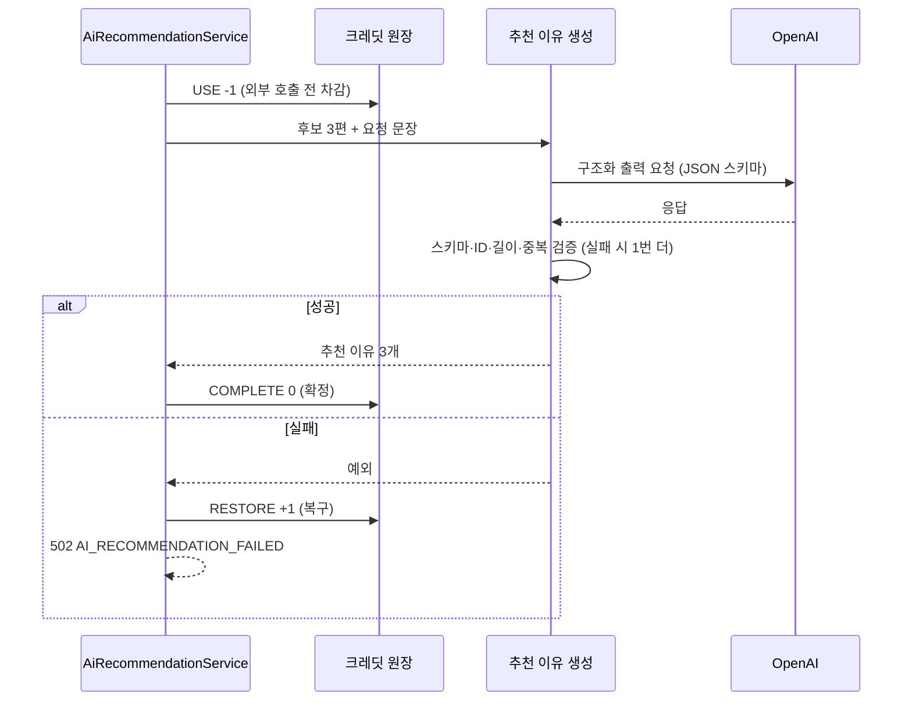

# AI 응답 형식 불일치 → 구조화 출력과 서버 검증

> AI가 기대와 다른 JSON 구조를 돌려줘 502가 나던 문제를, 스키마 지정·서버 검증·재시도·크레딧 복구로 막았습니다.

## 문제
개발 초기 로컬 Ollama로 추천 이유를 만들 때 실제 호출에서 502가 났습니다. 로그를 보니 AI가 `{ "reasons": [...] }` 객체 대신 최상위 배열 `[...]`을 돌려줘 Java 객체로 바꾸지 못했습니다.

## 원인
AI가 돌려주는 응답 형식을 서버가 기대하는 DTO 구조로 강제하지 못했습니다.

## 해결
운영은 OpenAI gpt-4o-mini를 씁니다.
- **구조화 출력**: `entity(AiMovieReasonBatch.class, spec -> spec.useProviderStructuredOutput().validateSchema())`로 JSON 스키마를 모델에 넘기고, 받은 결과를 스키마로 검증합니다(`SpringAiMovieReasonGenerator`).
- **서버 검증**: 영화 ID가 추천 후보와 정확히 같은지, 이유가 비어 있지 않고 200자 이내인지, 중복이 없는지 확인합니다. 서비스에서도 결과를 한 번 더 맞춰 봅니다(`AiRecommendationService`).
- **재시도**: 검증 실패는 이전 오류를 프롬프트에 붙여 최대 2번 시도합니다. 호출 자체의 오류는 바로 실패 처리합니다.
- **실패 처리**: 실패하면 사용한 크레딧을 같은 버킷(무료·유료)으로 돌려주고(RESTORE +1), 502 `AI_RECOMMENDATION_FAILED`를 돌려줍니다.
- **프롬프트 보호**: 영화 정보 안의 지시문을 무시하라는 규칙과 입력 길이 제한을 둡니다.

## 결과
형식이 어긋난 응답은 사용자에게 잘못된 추천으로 나가지 않고, 재시도 후에도 실패하면 크레딧이 복구됩니다. 원장(`ai_credit_transactions`)에 사용·확정·복구가 모두 한 줄씩 남습니다.

## 배운 점
AI 응답은 형식을 지정하고, 지정했더라도 서버에서 다시 검증합니다. 실패해도 사용자가 손해 보지 않게 크레딧을 복구합니다.
