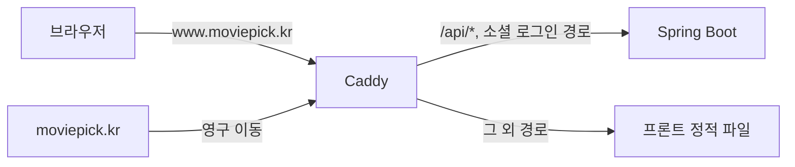

# GitHub 계정 제한으로 막힌 프론트 배포 → EC2 Caddy 단일 출처

> 외부 배포 서비스에 접근할 수 없게 되자, EC2의 Caddy가 화면과 API를 같은 주소로 내보내도록 바꿨고 인증 설정까지 단순해졌습니다.

## 문제
처음에는 프론트를 Vercel, 백엔드를 EC2에 두려고 설정했습니다. 그런데 기존 GitHub 계정이 제한되면서 GitHub 로그인 기반인 Vercel에 접근할 수 없게 됐습니다. 저장소도 새 조직(`300-moviepick`)으로 옮겼습니다.

## 원인
프론트 배포가 외부 서비스 계정 하나에 묶여 있었습니다.

## 해결
EC2의 Caddy가 프론트 정적 파일까지 제공합니다.
- `www.moviepick.kr`에서 `/api/*`와 소셜 로그인 경로(`/oauth2/authorization/*`, `/login/oauth2/*`)만 앱으로 넘기고, 나머지는 `/srv/front` 정적 파일로 응답합니다. 없는 경로는 `index.html`로 돌려줘 새로고침해도 화면이 유지됩니다(`Caddyfile`).
- 프론트 빌드 폴더를 Caddy 컨테이너에 읽기 전용으로 연결합니다(`docker-compose.prod.yml`).
- 소셜 로그인 콜백을 프론트 주소(www)로 고정합니다(`application-prod.yml`).
- 루트 주소 `moviepick.kr`은 www로 영구 이동시켜 쿠키·CORS 기준을 하나로 맞춥니다.

## 결과
- 화면과 API가 같은 주소라, 프론트는 운영에서 API 주소를 따로 두지 않고 상대 경로로 호출합니다(`moviepick-fe/src/api/client.js`).
- 화면과 API가 같은 사이트라 Refresh 쿠키를 `SameSite=Strict`로 둘 수 있습니다(`RefreshTokenCookieFactory`).
- 소셜 로그인 후 쿠키가 화면 도메인(www)에 저장됩니다.
- 배포 절차는 [DEPLOYMENT.md](../DEPLOYMENT.md)에 있습니다. 자동 배포는 없고, PC에서 빌드한 압축 파일을 서버에 올립니다.

## 배운 점
배포를 외부 계정 하나에 묶지 않고 서버 한 대에서 화면과 API를 같은 주소로 내보내면, CORS·쿠키 같은 인증 설정도 단순해집니다.
